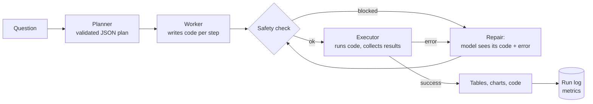

# Data Science Assistant

[](https://github.com/vhuthu106/data-science-assistant/actions/workflows/tests.yml)

Ask questions about a CSV file in plain English. An LLM plans the analysis, writes pandas code for
each step, runs it, repairs its own code when it fails, and shows the tables, charts and code.


## How it works



1. **Planner** (`agents/planner.py`): turns the question into 1–3 steps, using the dataset's
   column names and types (never its rows). The plan is validated against a fixed list of actions;
   an unusable reply falls back to a simple rule-based plan.
2. **Worker** (`agents/worker.py`): asks the model for pandas code for each step. If the code fails,
   the model is shown its own code and the exact error (with line number) and gets two chances to fix it.
   If a step still fails, or the provider is unavailable, the run stops cleanly and keeps finished steps.
3. **Safety check** (`core/safety.py`): generated code is parsed before it runs; file and network
   access, imports outside an allow-list, and Python internals are refused. While it runs, dangerous
   built-ins (`open`, `exec`, ...) do not exist.
4. **Executor** (`core/executor.py`): runs the code in a namespace shared by all steps (so step 2 sees
   step 1's changes), on a snapshot so a failed attempt can't leave half-finished changes. The answer is
   the variable `result`; charts, printed output and warnings are all captured.
5. **Run log** (`core/run_log.py`): records each question's real outcome (success, partial, failed or
   provider error) for the **Run Metrics** tab, including how often self-repair rescued failing code.

## Quick start

```bash
git clone https://github.com/vhuthu106/data-science-assistant.git
cd data-science-assistant
python3 -m venv .venv
source .venv/bin/activate          # Windows: .venv\Scripts\activate
pip install -r requirements.txt
cp .env.example .env               # then put your API key in .env
streamlit run app.py
```

Click **Load Titanic Dataset** (or upload a CSV) and ask, for example:
*"average fare by passenger class as a bar chart"* or
*"fill missing ages with the median, then plot the age distribution"*.

## Configuration (`.env`)

| Variable | Required | Meaning |
|---|---|---|
| `OPENAI_API_KEY` | yes | API key for the provider |
| `OPENAI_MODEL` | no | Model name (default `gpt-4.1-mini`) |
| `OPENAI_BASE_URL` | no | Any OpenAI-compatible provider |
| `LLM_TIMEOUT` | no | Seconds to wait for a reply (default 60) |
| `RUNS_DB` | no | Path of the run-log database (default `runs.db` next to the code) |

All model calls go through one module (`core/llm.py`), so switching provider is a configuration change:

| Provider | `OPENAI_BASE_URL` | Example `OPENAI_MODEL` |
|---|---|---|
| OpenAI | *(not set)* | `gpt-4.1-mini` |
| Google Gemini | `https://generativelanguage.googleapis.com/v1beta/openai/` | `gemini-3.5-flash` |
| Ollama (local, offline) | `http://localhost:11434/v1` | `qwen2.5-coder:7b` |

Provider problems (rate limits, overload, timeouts, wrong key or model) are shown as clear messages
that say what to do.

## Tests

```bash
pip install -r requirements-dev.txt
pytest
```

66 tests cover the executor, the safety checks (legitimate code runs, 14 attack patterns are blocked),
the planner's handling of good and malformed model replies, self-repair, provider errors (through the
real OpenAI SDK against a local fake server) and the Streamlit app itself (with `AppTest`).
The model is replaced by a fake in every test, so the suite needs no API key and costs nothing.
GitHub Actions runs it on every push.

## Privacy and safety

- Only the dataset's **column names, types and row count** are sent to the model, never the rows.
- The safety check is a **guard rail, not a sandbox**. Python cannot be fully locked down from inside
  itself; real isolation would run generated code in a separate process or container without file or
  network access.

## Limitations and next steps

- **No time limit on generated code:** an infinite loop would freeze the app. Running code in a separate
  process would allow a timeout (and stronger isolation).
- **Single-user design:** matplotlib's figure list is global, so simultaneous users could mix up charts.
- **One question at a time:** no follow-up questions that refer to earlier answers.
- **Answers depend on the model:** smaller or free-tier models plan and code less reliably, and free
  tiers have rate limits.

## Project structure

```
app.py                  Streamlit interface
agents/planner.py       question -> validated plan
agents/worker.py        plan steps -> code, self-repair
core/llm.py             the only module that talks to the model
core/executor.py        runs generated code, collects results
core/safety.py          checks generated code before and during execution
core/run_log.py         records outcomes for the metrics tab
tools/dataset_tools.py  loading datasets
tests/                  pytest suite
datasets/               Titanic example data
```

## History

This started as an earlier prototype. The overhaul (see the merged pull request and commit history)
fixed the code-execution and retry logic, removed a fragile fallback provider, added validation, safety
checks, honest metrics and a test suite.
